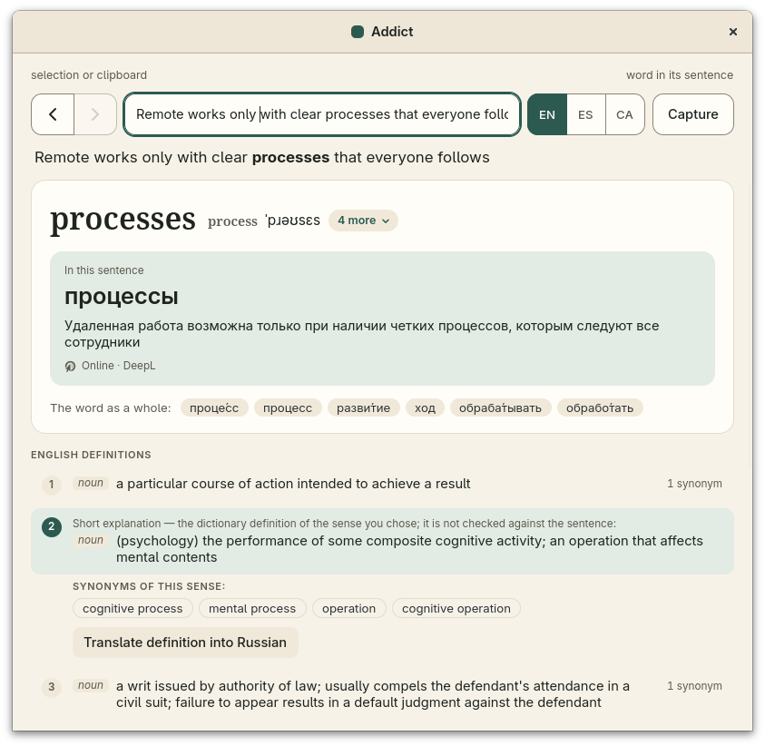

# addict

addict is a hotkey translator for Linux readers of English, Spanish and
Catalan. Select or copy a word or a sentence anywhere, press the shortcut, and
a small window shows the dictionary article of the word: its senses, synonyms,
transcriptions with recordings, and its Russian translations. Click a word of
a sentence and DeepL translates the word in that sentence, and the sentence
itself, into Russian. Text that cannot be selected, such as an image or a
video, can be captured from the screen and read with Tesseract OCR.



## Features

- One global shortcut reads the selected text, or the clipboard when nothing
  is selected, the same way in every application.
- Offline dictionary lookup in English, Spanish and Catalan, by the word as
  written and by its dictionary forms. When the reading language has
  dictionaries but none of them has the word, the other two are asked.
- Russian translations from the dictionaries and, online, from DeepL: the
  clicked word in the context of its sentence, the sentence, or a chosen
  definition. Answers are cached on disk for up to 90 days after their last
  use.
- Capture: choose an area of the screen, and its text replaces the field.
- A Russian word is looked up the other way: its translations into the
  reading language.
- An icon in the top bar with Show, Settings, About and Exit.

## Requirements

- Linux with GNOME 48 or later on Wayland, which has the GlobalShortcuts
  portal. KDE Plasma 6 may work but is not tested.
- GTK 4.20 or later. On a distribution with older GTK, such as Debian 13 or
  Ubuntu 24.04, the build from source fails; use the packages once they are
  out (see Install).
- Tesseract, with the data of English, Spanish and Catalan, for Capture
  only.
- A DeepL API key (the free plan is enough), for the online translations
  only.
- The top-bar icon needs a StatusNotifierItem host; on GNOME, the AppIndicator
  extension. Without one, addict runs without the icon.

## Install

Flathub and AppImage packages come with the first release. Until then, build
addict from source.

## Build from source

On Fedora 43, install the build tools and Tesseract:

```sh
sudo dnf install git gcc pkgconf-pkg-config gtk4-devel rust cargo \
    tesseract tesseract-langpack-eng tesseract-langpack-spa \
    tesseract-langpack-cat
```

Other distributions need the same: a C compiler, `pkg-config`, the GTK 4.20
development files, a recent stable Rust with Cargo (1.85 at least, for edition
2024), and Tesseract. Then build:

```sh
git clone https://github.com/doqhu/addict.git
cd addict
cargo build --release --locked
```

The program is `target/release/addict`. Register it with the desktop and
start it:

```sh
target/release/addict install
target/release/addict
```

`addict install` writes a desktop entry and the app icons into your home
directory; the entry also starts addict at login. The entry names the program
by its full path, so run `install` again if you move the program.
`addict uninstall` removes what `install` wrote.

On the first start, GNOME asks you to confirm the shortcut; addict suggests
Super+Q. You can change it later in Settings, from the top-bar icon.

### Where addict finds Tesseract

addict runs the program named in `~/.config/addict/tesseract` if that file
exists, else `tesseract` in the directory of the `addict` program, else
`tesseract` on `PATH`. It reads the language data from the directory named in
`~/.config/addict/tessdata` if that file exists, else from `../share/tessdata`
resolved from the directory of the `addict` program (for `/app/bin/addict`,
`/app/share/tessdata`), else from where Tesseract looks by itself
(`TESSDATA_PREFIX` is honoured). Each file holds an absolute path on its first
nonblank line; a relative path, or a file that cannot be read, is ignored. A
build from source with the system Tesseract needs neither file.

## Dictionaries

addict looks words up in dictionary indexes it builds from files you
download. A download on the first start is coming. For now, download the files
below and import each one:

```sh
target/release/addict import ~/Downloads/english-wordnet-2025.xml.gz
```

addict accepts only these exact editions: it checks each file's size and
SHA-256 before it writes anything. One index is enough to start, and the
window says which ones are missing. The indexes are kept in
`~/.local/share/addict`.

| Language | What it gives | File |
|----------|---------------|------|
| English | definitions and synonyms | [english-wordnet-2025.xml.gz][oewn] |
| English | Russian translations | [freedict-eng-rus-2025.11.23.src.tar.xz][freedict] |
| Spanish | Russian translations | [es-ru.sqlite3][es-ru] |
| Spanish | synonyms | [omw-es-2.0.tar.xz][omw-es] |
| Catalan | Russian translations | [ca-ru.sqlite3][ca-ru] |
| Catalan | synonyms | [th_ca_ES.dat][sinonims-cat] |
| Russian | English translations | [ru-en.sqlite3][ru-en] |
| Russian | Spanish translations | [ru-es.sqlite3][ru-es] |
| Russian | Catalan translations | [ru-ca.sqlite3][ru-ca] |

Two kinds of data are not listed yet. Kaikki gives the Spanish definitions and
the English glosses of Spanish and Catalan words, but it replaces its files
every week, so the editions addict accepts can no longer be downloaded.
DBnary gives the Catalan definitions; its server could not be reached when
this list was checked. Both come with the first-start download.
[CREDITS](CREDITS) names the authors and the license of each source.

[oewn]: https://github.com/globalwordnet/english-wordnet/releases/download/2025-edition/english-wordnet-2025.xml.gz
[freedict]: https://download.freedict.org/dictionaries/eng-rus/2025.11.23/freedict-eng-rus-2025.11.23.src.tar.xz
[es-ru]: https://download.wikdict.com/dictionaries/sqlite/2_2026-06/es-ru.sqlite3
[omw-es]: https://github.com/omwn/omw-data/releases/download/v2.0/omw-es-2.0.tar.xz
[ca-ru]: https://download.wikdict.com/dictionaries/sqlite/2_2026-06/ca-ru.sqlite3
[sinonims-cat]: https://github.com/Softcatala/sinonims-cat/releases/download/2.3.2/th_ca_ES.dat
[ru-en]: https://download.wikdict.com/dictionaries/sqlite/2_2026-06/ru-en.sqlite3
[ru-es]: https://download.wikdict.com/dictionaries/sqlite/2_2026-06/ru-es.sqlite3
[ru-ca]: https://download.wikdict.com/dictionaries/sqlite/2_2026-06/ru-ca.sqlite3

## Configuration

addict keeps its settings as small files in `~/.config/addict`
(`$XDG_CONFIG_HOME/addict` when that is set):

- `deepl.key` -- the DeepL API key. Enter it in Settings, which writes the
  file with mode `0600`; a file with any permission beyond `0600` is
  refused.
- `tesseract`, `tessdata` -- where to find Tesseract and its data (see above).
- `vulkan-drivers` -- which Vulkan driver GTK uses. By default addict picks
  the driver of the GPU that drives the display, so a sleeping discrete GPU
  stays asleep. `all` turns this off; any other line, such as `nvidia_icd*`,
  is used as is.
- `language` -- the reading language, written when you switch it in the
  window.

DeepL answers are cached in `~/.cache/addict`; Settings shows the cache size
and clears it.

## License

addict is licensed under the [MIT License](LICENSE). The dictionary data and
the OCR software and data it uses have their own licenses and credits, listed
in [CREDITS](CREDITS) and in the app under About → Credits.
The screenshot, `docs/screenshot.png`, shows dictionary data, so it is under
CC BY-SA 4.0 instead (see `REUSE.toml`).

## Use of AI in addict

addict was built with heavy use of generative AI. Below is each part of the
project, with how much of it AI wrote. The figures come from the git history
as of October 2026.

### Code

Almost all of the code was written by AI: Claude (Anthropic's Opus and Sonnet
models), through Claude Code. About 93% of the lines in the current source
tree come from AI-assisted commits. 103 of the project's 109 commits were
AI-assisted. This covers all crates and their tests.

The maintainer chose the features, directed the work and tested the result in
use. The maintainer did not review every line of the AI-written code.

### Documentation

The README, CONTRIBUTING and this disclosure are drafted by AI and edited by
the maintainer. Code comments were written by AI along with the code.

### Packaging, CI and project configuration

- **Flathub manifest:** written by the maintainer, with no AI-generated or
  AI-assisted content. It is separate from the development manifest below.
- **Flathub submission:** the pull request, its description, commit messages
  and replies are written by the maintainer, without AI.
- **Everything else:** the CI workflows, the secret-scan configuration, the
  check and acceptance scripts, the development Flatpak manifest
  (`packaging/flatpak`), its sources script (`scripts/flatpak-sources.sh`),
  the desktop entry (`data`), the AppImage recipe and the project
  configuration files (`Cargo.toml`, `REUSE.toml`, `.gitignore`) are written
  by AI under the maintainer's direction.

### Artwork

The app icon was made with an image-generation tool. The smaller sizes are
built from it by a script.

### Not counted above

AI was also used for research, discussion and debugging. That use did not add
anything to the repository by itself.
