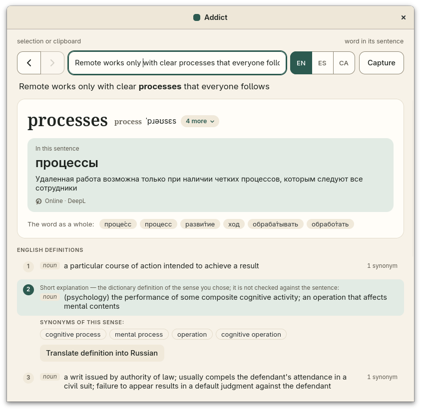

# addict

addict is a hotkey translator for Linux readers of English, Spanish, Catalan
and Russian. In Settings you choose your own language, the one addict
translates into; the other three are the languages you read.

Select or copy a word anywhere and press the shortcut: a small window shows
the word's dictionary article, with its senses, synonyms, transcriptions,
recordings and translations into your language. Select a whole sentence
instead, and DeepL translates it at once; click any of its words to see how
that word is translated in the sentence. Text that cannot be selected, such
as text in an image or a video, can be captured from the screen and read with
Tesseract OCR.



## Features

- **Two shortcuts.** One reads the selected text, or the clipboard when
  nothing is selected, the same way in every application. The other lets you
  choose an area of the screen; its text, read by OCR, goes into the window.
- **Your language.** Settings → My language chooses the language addict
  translates into: English, Spanish, Catalan or Russian (the default). The
  window's three language buttons choose among the other three. When English
  is your language, Settings → English spelling chooses US (the default) or
  British spelling for the online translations.
- **Offline dictionaries.** Words are looked up in English, Spanish and
  Catalan, as written and by their dictionary forms. When the dictionaries of
  the reading language don't have the word, the other two languages are
  tried.
- **Russian words.** When your language is English, Spanish or Catalan,
  Russian words are looked up offline too, inflected forms included. The
  article comes from Kaikki.org's extract of Russian Wiktionary: Russian
  definitions by sense, synonyms and IPA transcriptions. Recordings, when
  there are any, play online from Wikimedia Commons. When Russian is your
  language, Russian words are translated into the reading language.
- **Offline translations** for the pairs that have a dictionary today:
  English, Spanish and Catalan into Russian; Russian into English, Spanish
  and Catalan; and English glosses of Spanish and Catalan words. For any other
  pair, the window says that there is no offline dictionary for it yet.
- **Online translations** from DeepL, between any two of the four languages:
  a clicked word in the context of its sentence, the sentence itself, or a
  chosen definition. Answers are cached on disk for up to 90 days after their
  last use.
- **Sentences at once.** A sentence read by the shortcut is translated as
  soon as it appears. To translate it only after you click one of its words,
  turn off Settings → Translate sentence at once.
- **Top-bar icon** with Show, Settings, About and Exit.

## Requirements

- Linux with GNOME 48 or later on Wayland, which has the GlobalShortcuts
  portal. Hyprland works with `xdg-desktop-portal-hyprland` and a few lines of
  its configuration (see [Hyprland](#hyprland)). KDE Plasma 6 may work but is
  not tested.
- GTK 4.20 or later. On a distribution with older GTK, such as Debian 13 or
  Ubuntu 24.04, the build from source fails; use the AppImage or the Flatpak
  bundle (see Install).
- Tesseract, with the data of English, Spanish, Catalan and Russian, for
  Capture only.
- A DeepL API key (the free plan is enough), for the online translations
  only.
- The top-bar icon needs a StatusNotifierItem host; on GNOME, the AppIndicator
  extension. Without one, addict runs without the icon.

## Install

Each [release](https://github.com/doqhu/addict/releases) carries an AppImage
and a Flatpak bundle for x86_64, each with a `.sha256` file; `<version>` below
stands for the release's version, such as `0.5.0`. addict is not on Flathub
yet. To build it yourself, see Build from source.

### AppImage

The AppImage was tried on GNOME with Debian 13 and Ubuntu 24.04. It needs no
FUSE, and carries GTK and Tesseract, so it works where GTK is too old for a
build from source.

1. Download `Addict-<version>-x86_64.AppImage` and
   `Addict-<version>-x86_64.AppImage.sha256` from the release, and check
   the download:

   ```sh
   sha256sum --check Addict-<version>-x86_64.AppImage.sha256
   ```

2. Make it executable and start it:

   ```sh
   chmod +x Addict-<version>-x86_64.AppImage
   ./Addict-<version>-x86_64.AppImage
   ```

3. To add it to the application menu, open the file with
   [Gear Lever](https://flathub.org/apps/it.mijorus.gearlever) and let it
   integrate the app, or run `./Addict-<version>-x86_64.AppImage install`,
   which writes the same kind of desktop entry as a source build. Keep the
   file where it is: the entry names its path, so after moving it run
   `install` again.

To update, download the new release's AppImage and use it in place of the old
one. addict does not update itself. Settings, the dictionaries and the cache
stay where they are.

On Ubuntu 24.04, whose desktop portal is older, the AppImage starts and looks
words up, but Capture gives no text and Start at login is unavailable.

The release also carries what the AppImage's licenses require: its
corresponding sources (`Addict-<version>-x86_64.AppImage.sources.tar.00`, ...)
and the files of its build, described in
[docs/release.md](docs/release.md).

### Flatpak bundle

Download `Addict-<version>-x86_64.flatpak` and its `.sha256` file, then:

```sh
sha256sum --check Addict-<version>-x86_64.flatpak.sha256
flatpak install --user Addict-<version>-x86_64.flatpak
flatpak run io.github.doqhu.Addict
```

The bundle needs the GNOME runtime, which Flatpak installs from a remote
such as Flathub, so set that remote up first if you have not. A bundle does
not update itself: install the next release's bundle the same way. Before you
switch from a source build or an AppImage, see
[Switching to the Flatpak](#switching-to-the-flatpak).

## Build from source

On Fedora 43, install the build tools and Tesseract:

```sh
sudo dnf install git gcc pkgconf-pkg-config gtk4-devel rust cargo \
    tesseract tesseract-langpack-eng tesseract-langpack-spa \
    tesseract-langpack-cat tesseract-langpack-rus
```

Other distributions need the same: a C compiler, `pkg-config`, the GTK 4.20
development files, a recent stable Rust with Cargo (1.85 at least, for edition
2024), and Tesseract. Then build:

```sh
git clone https://github.com/doqhu/addict.git
cd addict
cargo build --release --locked
```

The program is `target/release/addict`. Register it with the desktop and
start it:

```sh
target/release/addict install
target/release/addict
```

`addict install` writes a desktop entry and the app icons into your home
directory, so addict appears among your applications. The entry names the
program by its full path, so run `install` again if you move the program.
`addict uninstall` removes what `install` wrote, and turns off login startup
first (see [Start at login](#start-at-login)).

### Where addict finds Tesseract

addict runs the program named in `~/.config/addict/tesseract` if that file
exists, else `tesseract` in the directory of the `addict` program, else
`tesseract` on `PATH`. It reads the language data from the directory named in
`~/.config/addict/tessdata` if that file exists, else from `../share/tessdata`
resolved from the directory of the `addict` program (for `/app/bin/addict`,
`/app/share/tessdata`), else from where Tesseract looks by itself
(`TESSDATA_PREFIX` is honoured). Each file holds an absolute path on its first
nonblank line; a relative path, or a file that cannot be read, is ignored. A
build from source with the system Tesseract needs neither file.

## Use

A normal launch shows the main window, also when addict is already running.
Closing the window or pressing Esc keeps addict running for its shortcuts.
Open Settings from the window's main menu or from the top-bar menu; the
top-bar icon is optional.

### Shortcuts

On the first start, the desktop asks you to confirm the shortcuts. The
clipboard shortcut suggests Super+Q and keeps a key you have already
assigned. The screenshot shortcut has no suggested key: open Settings →
Configure shortcuts… and give Screen region (OCR) a free key. Ubuntu's dock
uses Super+Q, so choose another key there. The desktop portal owns both
keys, and Settings shows any change at once.

Some desktop portals, stock GNOME among them, have no dialog to reopen later.
There, Configure shortcuts… registers both shortcuts again under new IDs, so
the desktop shows its dialog again with the current keys filled in;
cancelling it leaves the keys as they were. addict keeps the current IDs in
`shortcut-generation` in its configuration directory.

The screenshot shortcut opens the area picker even while the window is
closed. Choose an area and its text appears in the window, read in the
reading language, ready to edit. Cancelling starts no OCR and no
translation.

If a capture ends without a picture, the window opens with a line that says
what happened, and Capture has the focus: press Enter to try again. If the
shortcut is not bound, Retry has the focus instead. The window opens after
Esc as well, because GNOME reports Esc and a real failure the same way. GNOME
asks for no permission for an interactive screenshot, so there is nothing to
grant.

### Start at login

Turn on Settings → Start at login. addict asks the desktop's Background
portal to start it silently at each login, both in the Flatpak and in a
source build. A source build must run `addict install` first: the portal
knows addict by the desktop entry it writes. The portal cannot be asked what
is set, so the switch shows what the portal last confirmed. If the two drift
apart, for instance after you move the program or delete the entry by hand,
turn the switch off and on again.

An older version of addict wrote its own login entry, which keeps starting
addict and may open the window at each login. A source build then shows the
switch on, with a line saying so; turning it off and on replaces that entry
with the portal's.

`addict --background` (or `flatpak run io.github.doqhu.Addict --background`)
is the silent launch used at login. It stays silent even if the shortcuts
cannot be set up; launch addict normally to see the problem and Retry. The
flag does not set up login startup; the switch in Settings does.

`addict uninstall` asks the portal to remove addict's login entry before it
removes anything else. If the portal is unavailable or refuses, it removes
nothing and names the file. A file of that name that addict did not write,
or a symlink, is left alone, and the portal is not asked.

### Switching to the Flatpak

Before you switch from a source build or an AppImage to a Flatpak of addict
(a release bundle, Flathub, or a build from `packaging/flatpak`), run
`addict uninstall` (for an AppImage, `./Addict-<version>-x86_64.AppImage
uninstall`) and quit the running addict: choose Exit in its top-bar menu, or
run `pkill -x addict` when there is no icon. Otherwise the entry `install`
wrote hides the Flatpak's, and the running addict answers in place of the
Flatpak.

## Dictionaries

addict looks words up in dictionary indexes. The first start offers to download
the published indexes. Settings → Dictionaries → Download dictionaries checks
all published indexes and offers only missing or unreadable files. You can use
it after choosing Not now, or to restore a deleted or damaged index; healthy
files, including manually imported editions, are kept. To import an upstream
file yourself, download one from the table below, open Settings →
Dictionaries → Import file…, and choose it. addict builds its index in the
background and shows the result beside the button. A new dictionary is used
from the next lookup; a new edition of one already in use, after a restart.

Use this in-app route for Flatpak: its file chooser grants access to the
selected download through the desktop portal, with no additional filesystem
permissions. The command line remains available for a build from source:

```sh
target/release/addict import ~/Downloads/english-wordnet-2025.xml.gz
```

addict accepts only these exact editions: it checks each file's size and
SHA-256 before it writes anything. The Kaikki files are the exception: Kaikki
replaces them about every week, so addict accepts any edition of them by its
content (it must read as a Kaikki file and hold at least 10,000 headwords),
but only under its upstream name, as linked below; the older name
`kaikki.org-dictionary-Español.jsonl.gz` is accepted too. Such an index is
dated by the file's modification time. One index is enough to start, and the
window says which ones are missing. The indexes are kept in
`~/.local/share/addict`.

| Language | What it gives | File |
|----------|---------------|------|
| English | definitions and synonyms | [english-wordnet-2025.xml.gz][oewn] |
| English | Russian translations | [freedict-eng-rus-2025.11.23.src.tar.xz][freedict] |
| Spanish | Russian translations | [es-ru.sqlite3][es-ru] |
| Spanish | definitions and synonyms | [es-extract.jsonl.gz][kaikki-es] |
| Spanish | synonyms | [omw-es-2.0.tar.xz][omw-es] |
| Spanish | English glosses | [kaikki.org-dictionary-Spanish.jsonl.gz][kaikki-en-spanish] |
| Catalan | Russian translations | [ca-ru.sqlite3][ca-ru] |
| Catalan | definitions | [ca_dbnary_ontolex_2026-10-01.ttl.bz2][dbnary-ca] |
| Catalan | synonyms | [th_ca_ES.dat][sinonims-cat] |
| Catalan | English glosses | [kaikki.org-dictionary-Catalan.jsonl.gz][kaikki-en-catalan] |
| Russian | definitions, synonyms, IPA and word forms from Kaikki.org’s Russian Wiktionary extract | [raw-wiktextract-data.jsonl.gz][kaikki-ru] |
| Russian | English translations | [ru-en.sqlite3][ru-en] |
| Russian | Spanish translations | [ru-es.sqlite3][ru-es] |
| Russian | Catalan translations | [ru-ca.sqlite3][ru-ca] |

[CREDITS](CREDITS) names the authors and the license of each source.

[oewn]: https://github.com/globalwordnet/english-wordnet/releases/download/2025-edition/english-wordnet-2025.xml.gz
[freedict]: https://download.freedict.org/dictionaries/eng-rus/2025.11.23/freedict-eng-rus-2025.11.23.src.tar.xz
[es-ru]: https://download.wikdict.com/dictionaries/sqlite/2_2026-06/es-ru.sqlite3
[kaikki-es]: https://kaikki.org/dictionary/downloads/es/es-extract.jsonl.gz
[omw-es]: https://github.com/omwn/omw-data/releases/download/v2.0/omw-es-2.0.tar.xz
[kaikki-en-spanish]: https://kaikki.org/dictionary/Spanish/kaikki.org-dictionary-Spanish.jsonl.gz
[ca-ru]: https://download.wikdict.com/dictionaries/sqlite/2_2026-06/ca-ru.sqlite3
[dbnary-ca]: https://kaiko.getalp.org/static/ontolex/ca/ca_dbnary_ontolex_2026-10-01.ttl.bz2
[sinonims-cat]: https://github.com/Softcatala/sinonims-cat/releases/download/2.3.2/th_ca_ES.dat
[kaikki-en-catalan]: https://kaikki.org/dictionary/Catalan/kaikki.org-dictionary-Catalan.jsonl.gz
[kaikki-ru]: https://kaikki.org/ruwiktionary/raw-wiktextract-data.jsonl.gz
[ru-en]: https://download.wikdict.com/dictionaries/sqlite/2_2026-06/ru-en.sqlite3
[ru-es]: https://download.wikdict.com/dictionaries/sqlite/2_2026-06/ru-es.sqlite3
[ru-ca]: https://download.wikdict.com/dictionaries/sqlite/2_2026-06/ru-ca.sqlite3

## Configuration

addict keeps its settings as small files in `~/.config/addict`
(`$XDG_CONFIG_HOME/addict` when that is set; for the Flatpak,
`~/.var/app/io.github.doqhu.Addict/config/addict`). Settings writes most of
them, so you rarely need to edit one:

- `deepl.key` -- the DeepL API key. Enter it in Settings, which writes the
  file with mode `0600`; a file with any permission beyond `0600` is
  refused.
- `tesseract`, `tessdata` -- where to find Tesseract and its data (see above).
- `vulkan-drivers` -- which Vulkan driver GTK uses. By default addict picks
  the driver of the GPU that drives the display, so a sleeping discrete GPU
  stays asleep. `all` turns this off; any other line, such as `nvidia_icd*`,
  is used as is.
- `language` -- the reading language, written when you switch it in the
  window.
- `my-language` -- your language, the language of translation: `en`, `es`,
  `ca` or `ru`, written when you choose it in Settings. Without the file it is
  Russian.
- `english` -- the spelling of English for online translations, `us` or `gb`,
  written when you choose it in Settings. Without the file it is US.
- `translate-sentence` -- whether a sentence read by the shortcut is
  translated at once, `on` or `off`, written when you move the switch in
  Settings. Without the file it is `on`.
- `login-startup`, `shortcut-generation`, `first-run-download` -- what the
  portal last confirmed for Start at login, the current shortcut IDs, and
  whether the first-run download was declined. addict writes these itself.

DeepL answers are cached in `~/.cache/addict` (for the Flatpak,
`~/.var/app/io.github.doqhu.Addict/cache/addict`); Settings shows the cache
size and clears it.

### Hyprland

Hyprland's portal can't choose keys, and Hyprland tiles every window, so
both are set in Hyprland's configuration. addict registers its two shortcuts
under fixed names: `io.github.doqhu.Addict:invoke` (selection or clipboard)
and `io.github.doqhu.Addict:screenshot` (Capture). Settings → Copy Hyprland
lines puts these lines on the clipboard; add them to
`~/.config/hypr/hyprland.lua`, with other keys if you like:

```lua
hl.bind("SUPER + Q", hl.dsp.global("io.github.doqhu.Addict:invoke"), { description = "Addict: translate selection or clipboard" })
hl.bind("SUPER + SHIFT + Q", hl.dsp.global("io.github.doqhu.Addict:screenshot"), { description = "Addict: capture a screen region (OCR)" })
hl.window_rule({ name = "addict", match = { class = "^io\\.github\\.doqhu\\.Addict$" }, float = true, center = true })
```

The rule floats and centres every addict window at the size it opens with.
`hyprctl globalshortcuts` lists the names addict registered. Capture needs
`grim` and `slurp`, which the portal runs to choose the area.

## License

addict is licensed under the [MIT License](LICENSE). The dictionary data and
the OCR software and data it uses have their own licenses and credits, listed
in [CREDITS](CREDITS) and in the app under About → Credits.
The screenshot, `docs/screenshot.png`, shows dictionary data, so it is under
CC BY-SA 4.0 instead (see `REUSE.toml`).

## Use of AI in addict

addict was built with heavy use of generative AI. Below is each part of the
project, with how much of it AI wrote. The figures come from the git history
at commit `f59cf7e` (12 November 2026); `scripts/ai-figures.sh f59cf7e`
reproduces them.

### Code

Almost all of the code was written by AI: Claude (Anthropic's Opus and Sonnet
models), through Claude Code, in 126 commits, and OpenAI's Codex in 7. Over
99% of the lines in the tracked files (generated and license files included)
come from AI-assisted commits. 133 of the project's 139 commits were
AI-assisted; the other six are five merge commits and a release-please
commit. This covers all crates and their tests.

The maintainer chose the features, directed the work and tested the result in
use. The maintainer did not review every line of the AI-written code.

### Documentation

The README, CONTRIBUTING and this disclosure are drafted by AI and edited by
the maintainer. Code comments were written by AI along with the code.

### Packaging, CI and project configuration

- **Flathub manifest:** written by the maintainer, with no AI-generated or
  AI-assisted content. It is separate from the development manifest below.
- **Flathub submission:** the pull request, its description, commit messages
  and replies are written by the maintainer, without AI.
- **Everything else:** the CI workflows, the secret-scan configuration, the
  check and acceptance scripts, the development Flatpak manifest
  (`packaging/flatpak`), its sources script (`scripts/flatpak-sources.sh`),
  the crate license list's configuration (`packaging/licenses`) and script
  (`scripts/crate-licenses.sh`), the figures script (`scripts/ai-figures.sh`),
  the desktop entry and the MetaInfo
  (`data`), the AppImage recipe and the project configuration files
  (`Cargo.toml`, `REUSE.toml`, `.gitignore`) are written by AI under the
  maintainer's direction.

### Artwork

The app icon was made with an image-generation tool. The smaller sizes are
built from it by a script.

### Not counted above

AI was also used for research, discussion and debugging. That use did not add
anything to the repository by itself.
